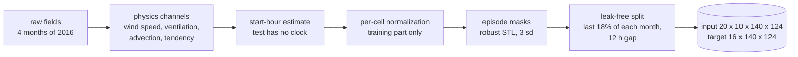
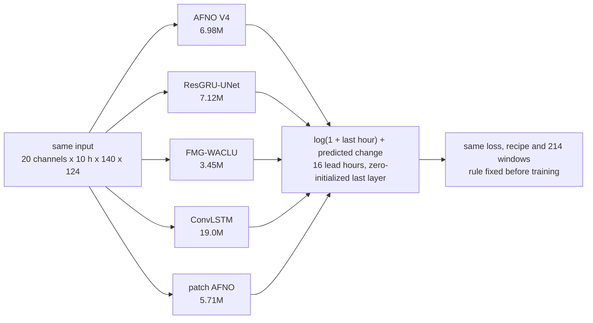
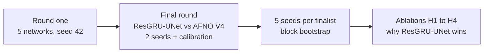

<div align="center">

# PM2.5 forecasting over India with deep learning

**A controlled backbone study: five deep networks trained inside one fixed pipeline, so the network is the only difference**

[](pyproject.toml)
[](https://github.com/Vetri-78640/aml_dl_pm2.5/tree/phase1)
[](#results)
[](https://www.kaggle.com/competitions/anrf-aise-hack-phase-2-theme-2-pollution-forecasting-iitd)
[](tests/)

AML/DL Project 19 - Team T024, Section A - Phase 2

[Overview](#overview) -
[Dataset](#dataset) -
[Pipeline](#preprocessing-pipeline) -
[Evaluation](#evaluation-protocol) -
[Models](#models) -
[Training](#training) -
[Results](#results) -
[Quick start](#quick-start) -
[Structure](#repository-structure) -
[Team](#team)

</div>

---

## Overview

The task is a 16-hour PM2.5 forecast over India, made from 10 hours of WRF-Chem fields on a 140 x 124 grid. AFNO V4 (a U-Net with Adaptive Fourier Neural Operator blocks) was the team's best model, at a test score of 0.8833. But the pipeline changed alongside the AFNO iterations: a leak-free split, official episode masks, an hour fix and physics channels. So the leaderboard scores of the model families mix architecture with pipeline. This study asks one question: **once every network gets the same pipeline, is AFNO V4 still the best?**

Each network is trained inside AFNO V4's fixed pipeline: same inputs, split, loss, schedule, epochs and validation windows. The decision rule was written down on 2026-11-07, before any training.

**Answer:** no. ResGRU-UNet (a U-Net with a ConvGRU over lead time) beats AFNO V4:
- on all 25 seed pairs, at every lead hour, in every month and in 95% of grid cells;
- on MAE, RMSE and R².

The pipeline mattered more than the backbone: moving one network into the improved pipeline gained 6 to 8 times more than swapping the network.

| Stage | Approach | Status |
|:--|:--|:--|
| Data and EDA | Files, grid, PM2.5 in space and time, predictability, transport: [`01_data_and_eda`](notebooks/01_data_and_eda.ipynb) | Done |
| Preprocessing | Physics channels, normalization, episode masks, leak-free split, hour estimation: [`02_preprocessing`](notebooks/02_preprocessing.ipynb) | Done |
| Models | Five networks behind one interface, each port checked against its original: [`03_models`](notebooks/03_models.ipynb) | Done |
| Training | One recipe for every network, regularization, training curves: [`04_training`](notebooks/04_training.ipynb) | Done |
| Evaluation | Benchmark score, persistence, seasonal naive, ridge, MAE / RMSE / R²: [`05_evaluation`](notebooks/05_evaluation.ipynb) | Done, test scored |
| Controlled study | Round one, final round, 5 seeds, ablations: [`06_analysis_and_ablations`](notebooks/06_analysis_and_ablations.ipynb) | Done, test scored |
| ML + DL hybrid | LightGBM correction of the ResGRU-UNet ensemble, tested by leaving one month out: [`src/hybrid.py`](src/hybrid.py) | Done, no gain |
| Report | [`reports/report.pdf`](reports/report.pdf) | Done |
| Slides | [`reports/phase2_slides.pdf`](reports/phase2_slides.pdf) | Done |

---

## Dataset

The ANRF AISEHack 2026 challenge (Phase 2, Theme 2, IIT Delhi) released WRF-Chem simulation fields on [Kaggle](https://www.kaggle.com/competitions/anrf-aise-hack-phase-2-theme-2-pollution-forecasting-iitd). The data is not in this repo; see [`data/README.md`](data/README.md).

<table>
<tr><td>

| | |
|:--|--:|
| Grid | 140 x 124, Mercator, about 25 km |
| Area | 7.06 to 38.00 N, 67.79 to 97.93 E |
| Period | April, July, October, December 2016 |
| Hours per month | 715 to 739, hourly |
| Task | 10 input hours to 16 forecast hours |
| Test | 218 windows, targets hidden |

</td><td>

| Field | Meaning |
|:--|:--|
| `cpm25` | PM2.5 concentration, target |
| `q2` / `t2` | 2 m humidity / temperature |
| `u10` / `v10` | 10 m wind components |
| `pblh` | planetary boundary layer height |
| `psfc` | surface pressure |
| `swdown` / `rain` | shortwave radiation / rain |

</td></tr>
</table>

**What the EDA found** ([`01_data_and_eda`](notebooks/01_data_and_eda.ipynb))

- **Heavy right tail.** Skewness is 5.1, and 0.13 after log(1 + y). The December mean (59.1 µg/m³) is 2.5 times its median, so every model works in log space.
- **Strong seasons and hotspots.**
  - The monthly mean ranges from 15.4 µg/m³ in July to 59.1 in December.
  - Pollution concentrates over the Indo-Gangetic Plain and the eastern coal belt.
  - So inputs are normalized per cell, and a per-cell climatology is a static input.
- **Persistence is strong.**
  - The autocorrelation of log PM2.5 is 0.978 at 1 h and 0.728 at 6 h.
  - The spread of the change grows five-fold from hour 1 to hour 16 (sd 0.101 to 0.505).
  - So every network predicts the change from the last hour, and later lead hours get more weight in the loss.
- **Transport is local.** At the mean 10 m wind (4.24 m/s), PM2.5 travels about 244 km in 16 h, or about 10 cells. A receptive field of that size is enough, and an advection channel supplies the transport term directly.
- **Unused fields.** The seven emission fields are near zero (about 1e-8 to 1e-7) and are not used. The test windows carry no timestamps, so their start hour is estimated.

---

## Preprocessing pipeline



| Step | What it does | Why |
|:--|:--|:--|
| Physics channels | wind speed, ventilation log(1 + PBLH x wind), advection of log PM2.5, PM tendency, diurnal anomaly | stagnation and transport drive episodes |
| Hour estimate | matches each window's radiation and temperature to hourly templates; exact for 60.7% of validation windows, within one hour for 97.7% | test windows have no timestamps; validation uses the same estimate |
| Normalization | per-cell mean and sd from the training part of each month only, sd floored | no statistics from validation hours |
| Episode masks | an hour is an episode when its robust STL residual exceeds 3 sd of the cell's residuals and the value exceeds 1 µg/m³ (1.7 to 2.2% of cell-hours) | the benchmark scores episode cells separately |
| Split | last 18% of every month held out, 12 h gap; 2,257 training and 214 validation windows | windows 1 h apart share 96% of their hours, so a random split leaks |
| Input | 20 channels: 9 fields, 4 physics channels, hour sin / cos, diurnal anomaly, latitude, longitude, PM2.5 climatology, episode sigma | the same input for every network |

The recomputed normalization stats match V4's to within 7e-6, and a recomputed episode mask matches V4's exactly ([`02_preprocessing`](notebooks/02_preprocessing.ipynb)).

---

## Evaluation protocol

**Benchmark score.** Write SMAPE as |p - y| / ((|p| + |y|) / 2). Then:
- G is the mean SMAPE over all cells and hours, and E is its mean over episode cells;
- ρ is the Pearson correlation on episode cells, averaged over hours;
- the score is the mean of (1 - G/2), (1 + ρ)/2 and (1 - E/2), with equal weights on validation.

| Set | What it gives |
|:--|:--|
| Validation | the same 214 windows for every model: score, MAE, RMSE and R² |
| Test (Kaggle private leaderboard) | score only, since targets are hidden; every study run was submitted after the deadline, so none is ranked |

**Decision rule, fixed before training**
1. The primary measure is the validation score of the best epoch.
2. A network X is better than AFNO V4 only if it leads by more than 0.003 on validation **and** also scores higher on the test set.
3. A validation gap of 0.003 or less is a tie. If validation and test disagree, the result is inconclusive.
4. Known bias: the recipe was tuned for AFNO V4, so a narrow AFNO win is weak evidence.

MAE, RMSE and R² exist only on validation. The leaderboard has no R²: its correlation term is the Pearson r on episode cells.

---

## Models



| Network | Design | Inductive bias | Params |
|:--|:--|:--|--:|
| ResGRU-UNet | 10 hours stacked as 200 channels; conv U-Net to 18 x 16; ConvGRU unrolled over the 16 lead hours; per-lead decoder with full-resolution skips | multi-scale convolution, recurrent state from hour to hour | 7,122,113 |
| AFNO V4 | shared conv encoder per hour; one AFNO block at 35 x 31 and six at 18 x 16; temporal translator 10 to 16 hours; two AFNO blocks per lead hour; U-Net decoder | global spectral mixing in every block | 6,980,033 |
| FMG-WACLU | ConvLSTM U-Net with wind speed, direction and divergence, gated by weather rolled forward by a second ConvLSTM | recurrence plus wind physics | 3,454,645 |
| ConvLSTM | ConvLSTM over the input hours at full resolution, an FNO-style spectral block, a shift of the PM2.5 map along the wind | recurrence plus a semi-Lagrangian step | 19,001,840 |
| patch AFNO | 4 x 4 patches, AFNO blocks, one linear layer back to the grid | global spectral mixing on patches | 5,708,800 |

Every port was checked against its original Kaggle notebook ([`reference/originals/`](reference/originals/)). The original is rebuilt, its logged parameter count is confirmed, and the port's output is confirmed identical for the same weights. All checks pass. Only these things changed:
- the input width;
- for ConvLSTM and patch AFNO, the residual output;
- ConvLSTM's season FiLM, removed because there is no season input;
- one bug fix in patch AFNO, described below.

The AFNO V4 training script is kept unchanged in [`reference/afno_v4/`](reference/afno_v4/).

**Patch AFNO bug.** The original calls `torch.fft.irfft2(xf.float(), ...)`. `.float()` on a complex tensor keeps only the real part, so half of every filtered spectrum was dropped; the original Kaggle log shows the warning at that line. The port passes the complex spectrum intact.

---

## Training

| Item | Setting, the same for every network |
|:--|:--|
| Loss | 0.40 Huber on log(1 + y) (episode cells x 6) + 0.25 global SMAPE + 0.15 episode SMAPE + 0.20 (1 - episode correlation) |
| Lead-hour weights | linear 0.7 to 1.3 in the Huber and global terms |
| Optimizer | AdamW, lr 2.5e-4, weight decay 1e-4, one-cycle schedule, 16 epochs |
| Batch | effective 4; micro-batch picked by a memory probe, gradients accumulated |
| Regularization | EMA of the weights 0.999, gradient clipping 1.0, input clipping at 10, best epoch by validation score; each network keeps its own dropout (channel dropout 0.1 in ResGRU-UNet and AFNO V4) |
| Precision, hardware | mixed precision, one Kaggle T4 GPU; ResGRU-UNet about 50 min per run, AFNO V4 about 90 min |

Details and the curves of all 15 logged runs: [`04_training`](notebooks/04_training.ipynb).

---

## Results



**Round one: five networks, one pipeline, seed 42, no calibration**

| Network | Params | Val score | Test score | Against AFNO V4 |
|:--|--:|--:|--:|:--|
| ResGRU-UNet | 7.12M | **0.9158** | **0.8798** | better |
| AFNO V4 (reference) | 6.98M | 0.9110 | 0.8762 | - |
| FMG-WACLU | 3.45M | 0.9099 | 0.8710 | tie |
| patch AFNO | 5.71M | 0.9031 | 0.8530 | worse |
| ConvLSTM | 19.0M | 0.8945 | 0.8452 | worse |

**Final round and 5 seeds**

| | AFNO V4 | ResGRU-UNet |
|:--|--:|--:|
| 2 seeds, val | 0.9131 | **0.9175** |
| 2 seeds + calibration, test | 0.8833 | **0.8898** |
| 5 single seeds, val mean (sd) | 0.91146 (0.00059) | **0.91630** (0.00104) |
| 5 single seeds, test mean (sd) | 0.87540 (0.00130) | **0.87994** (0.00085) |
| 5-seed ensemble, val | 0.9145 | **0.9193** |
| 5-seed ensemble + calibration, test | 0.8848 | **0.8914** |

- ResGRU-UNet wins 25 of 25 seed pairs on validation and on test.
- The 5-seed ensemble gap on validation is +0.00479, with a 95% block bootstrap interval of [+0.00383, +0.00578].
- It leads at every lead hour (gap 0.0018 at hour 1, up to 0.0061) and in every month.
- It has the lower MAE in 90.5% of cells and the lower SMAPE in 94.7% ([`06_analysis_and_ablations`](notebooks/06_analysis_and_ablations.ipynb)).

**Regression metrics on validation** (214 windows, µg/m³; skill = RMSE reduction against persistence)

| Model | MAE | RMSE | R² | Skill | Score |
|:--|--:|--:|--:|--:|--:|
| Persistence | 10.44 | 26.46 | 0.767 | 0.0% | 0.8515 |
| Seasonal naive (same hour, 24 h earlier) | 11.53 | 26.80 | 0.761 | -1.3% | 0.7907 |
| Ridge regression (no neural network) | 8.51 | 21.48 | 0.847 | 18.8% | 0.8637 |
| ConvLSTM, seed 42 | 7.05 | 18.93 | 0.881 | 28.5% | 0.8945 |
| patch AFNO, seed 42 | 6.85 | 19.02 | 0.880 | 28.1% | 0.9031 |
| FMG-WACLU, seed 42 | 7.14 | 19.32 | 0.876 | 27.0% | 0.9099 |
| AFNO V4, 5-seed mean | 6.99 | 19.45 | 0.874 | 26.5% | 0.9145 |
| **ResGRU-UNet, 5-seed mean** | **6.32** | **18.04** | **0.892** | **31.8%** | **0.9193** |

The baselines are recomputed from the raw data in [`05_evaluation`](notebooks/05_evaluation.ipynb) and match the Kaggle runs exactly. Calibration raises the benchmark score but worsens MAE, RMSE and R² (ResGRU-UNet: MAE 6.32 to 7.12), so this table uses the uncalibrated means.

**Pipeline against backbone** (test, seed 42, no calibration)

| Network | Its own pipeline | AFNO V4 pipeline | Gain |
|:--|--:|--:|--:|
| ResGRU-UNet | 0.8506 | 0.8798 | +0.0292 |
| FMG-WACLU | 0.8465 | 0.8710 | +0.0245 |
| patch AFNO | 0.8218 | 0.8530 | +0.0312 |

At the same setting, the backbone gap (ResGRU-UNet over AFNO V4) is +0.0036.

**Ablations: why ResGRU-UNet wins.** There are four hypotheses, each tested with one change on one seed, and each prediction was written down before its run. A change counts only if it moves validation by more than max(2 sd, 0.002) from its family's 5-seed mean.

| Hypothesis | Variant | Change | Val | Shift | Result |
|:--|:--|:--|--:|--:|:--|
| H1 full-resolution time information | `afnov4_allskip` | AFNO V4 skips fuse all 10 hours | 0.91259 | +0.00113 | not resolved |
| H2 spectral wrap-around | `afnov4_pad` | AFNO blocks on a zero-padded 2H x 2W map | 0.91062 | -0.00084 | not resolved |
| H3 soft thresholding removes detail | `afnov4_nosparse` | soft threshold 0.01 to 0 | 0.91094 | -0.00052 | not resolved |
| H4 lead-time recurrence | `resgru_norec` | ConvGRU replaced by per-lead conv blocks | 0.91456 | -0.00174 | not resolved |

No single change explains the 0.0048 gap. An exploratory finding, not pre-registered: at the same training loss, AFNO V4's validation loss is 6.8% higher than ResGRU-UNet's across seeds, a larger generalization gap.

**ML + DL hybrid: a gradient-boosted correction of the network.** A LightGBM model (300 trees, Huber loss) predicts the log error of the uncalibrated ResGRU-UNet 5-seed ensemble from 33 features: the 20 input channels at the last hour, log PM2.5 at the 9 earlier hours, the ensemble forecast, its change from the last hour, the spread of the 5 seeds and the lead hour. The rule was fixed before the run: fit on the validation windows of three months, predict the fourth, and call the hybrid better only if its pooled score is higher and it wins in at least 3 of 4 months.

| Model (validation, out of fold) | MAE | RMSE | R² | Episode SMAPE | Score |
|:--|--:|--:|--:|--:|--:|
| ResGRU-UNet 5-seed ensemble | 6.32 | 18.04 | 0.892 | 0.235 | **0.9193** |
| Hybrid: ensemble + LightGBM correction | 6.42 | 17.75 | 0.895 | 0.305 | 0.9051 |

Verdict: no gain. The hybrid lost in all four held-out months (April -0.0162, July -0.0151, October -0.0068, December -0.0188). RMSE and R² improved slightly, but episode SMAPE got worse, so the hybrid is not used and was not submitted to the test set. The validation windows also chose each network's best epoch, so this tests the correction only. Record: [`results/hybrid/hybrid.json`](results/hybrid/hybrid.json).

**How the pipeline got here** (test score, Kaggle private leaderboard; [`results/earlier_iterations.csv`](results/earlier_iterations.csv))

| Iteration | Model | Change | Test |
|:--|:--|:--|--:|
| 1 | patch AFNO | AFNO on 4 x 4 patches, random split | 0.8218 |
| 2 | ResGRU-UNet | U-Net + ConvGRU, output added to the last hour, log Huber loss | 0.8506 |
| 3 | ResGRU-UNet | fine-tunes on missed episode peaks, pinball loss q = 0.75 | 0.8594 |
| 4 | ResGRU-UNet | blends with models trained at q = 0.85 and 0.90 | 0.8648 |
| 5 | AFNO-SimVP blend | temporal hold-out, AFNO with a SimVP translator | 0.8561 |
| 6 | AFNO V3 | official STL episodes, exact score for selection, 12 h gap, hour estimation | 0.8609 |
| 7 | AFNO V4 | physics channels, multiscale block, lead-hour weights, 2 seeds, calibration | 0.8833 |
| 8 | ResGRU-UNet | in the V4 pipeline, 5 seeds, calibration | **0.8914** |

All result tables: [`reports/results.md`](reports/results.md). Full write-up: [`reports/report.pdf`](reports/report.pdf).

---

## Quick start

```bash
git clone https://github.com/Vetri-78640/dl_pm2.5.git
cd dl_pm2.5
pip install -e ".[dev]"            # or: pip install -r requirements.txt

pytest                             # config against the code, seconds
pytest -m dryrun                   # every dry run and the port check, CPU, about 35 min
```

| Task | Command |
|:--|:--|
| Download the data | see [`data/README.md`](data/README.md) |
| Re-run a notebook | `jupyter nbconvert --to notebook --execute --inplace notebooks/01_data_and_eda.ipynb` |
| Port check only | `python tests/local_check.py reference/originals` |
| One dry run | `python tests/dry_run.py` |
| Run a stage on Kaggle | `uvx --python 3.12 --from kaggle==2.2.5 --with six kaggle kernels push -p notebooks/kaggle/<stage> --accelerator NvidiaTeslaT4` |

All six notebooks run on a laptop CPU in seconds, except `03_models` (about 3.5 min). Notebooks 01, 02, 03 and 05 need the downloaded data; 04 and 06 read only `results/`. They import the code exactly as it ran on Kaggle, through [`src/local.py`](src/local.py). No network is retrained locally.

The settings live in [`configs/study.yaml`](configs/study.yaml): data, split, episodes, AFNO V4, training, evaluation and ridge. The Kaggle notebooks ran with the same values from the config class in `src/study.py`, and [`tests/test_config.py`](tests/test_config.py) fails if the two ever disagree.

**Rules for the Kaggle notebooks**

- [`notebooks/kaggle/`](notebooks/kaggle/) holds the 16 notebooks exactly as they ran, each with its `run_log.txt`.
- The builders (`scripts/build_*.py`) write into that folder and would overwrite them, so run builders only in a copy of the repo.
- Rebuilding a round-one notebook from the current `src/study.py` changes one line: those notebooks hard-code seed 42, while `study.py` now reads a top-level `SEED`.
- Each training notebook checks for a usable GPU and the attached data. It also re-evaluates the V4 seed-42 checkpoint and stops if the result is more than 0.002 from its logged score. It saves a checkpoint every epoch, stops cleanly at a 10.5 h time budget and can resume from its own output.

**Outputs**

| Path | Contents |
|:--|:--|
| `results/<stage>/summary*.json`, `train_log.csv` | each Kaggle run: best epoch, scores, timing, per-epoch losses |
| `results/regression/`, `baselines/`, `ridge/` | MAE, RMSE, R² and score for every model and baseline |
| `results/analysis/analysis.json` | 5-seed statistics, block bootstrap, breakdowns by lead hour, month and concentration |
| `results/maps/` | per-cell error maps, 5-seed means |
| `results/hybrid/hybrid.json` | the hybrid's out-of-fold scores, per month, rule and verdict |
| `results/test_scores.csv`, `earlier_iterations.csv` | every test score of the study, the pipeline history |
| `reports/report.pdf`, `reports/paper/`, `reports/figures/` | the report, its source and figures |

---

## Repository structure

```
dl_pm2.5/
├── configs/
│   └── study.yaml                 study settings, checked against the code
├── data/                          competition data, not committed (README with download steps)
├── notebooks/
│   ├── 01_data_and_eda.ipynb      files, grid, PM2.5 in space and time, transport
│   ├── 02_preprocessing.ipynb     physics channels, stats, masks, split, hour estimation
│   ├── 03_models.ipynb            the networks, a forward pass, the port check
│   ├── 04_training.ipynb          recipe, loss, regularization, training curves
│   ├── 05_evaluation.ipynb        score, baselines, ridge, MAE / RMSE / R², calibration
│   ├── 06_analysis_and_ablations.ipynb  decision rules, rounds, 5 seeds, maps, ablations
│   └── kaggle/                    the 16 Kaggle notebooks as they ran, with run logs
├── src/
│   ├── study.py                   shared pipeline and all 5 networks (Kaggle source)
│   ├── ablations.py               the four single-change variants
│   ├── final_round.py             seed ensembles and calibration
│   ├── analysis.py                5-seed analysis and block bootstrap
│   ├── regression.py              MAE, RMSE and R² for every model
│   ├── baselines.py, ridge.py     persistence, seasonal naive, ridge regression
│   ├── maps.py                    per-cell error maps
│   ├── hybrid.py                  LightGBM correction of the network ensemble
│   └── local.py                   loads the as-ran code for the local notebooks
├── scripts/
│   ├── build_*.py                 build each Kaggle notebook from src/
│   ├── ablation_verdict.py        applies the pre-registered rule to the ablations
│   └── tools/                     Kaggle run and submission helpers
├── tests/
│   ├── test_config.py             configs/study.yaml against the code
│   ├── test_dry_runs.py           pytest wrapper for the dry runs and the port check
│   ├── dry_run*.py                each stage end to end on synthetic data, CPU
│   └── local_check.py             every port against its original
├── results/                       run records downloaded from Kaggle
├── reference/
│   ├── afno_v4/                   AFNO V4 training script, unchanged
│   └── originals/                 original notebooks of the four ported networks
├── reports/
│   ├── report.pdf                 the Phase 2 report
│   ├── phase2_slides.pdf          the Phase 2 presentation
│   ├── paper/                     report.tex and its figures
│   ├── figures/                   5-seed figures
│   └── results.md                 every result table
└── pyproject.toml
```

---

## Roadmap

- [x] EDA and preprocessing of the WRF-Chem data
- [x] Five networks ported to one interface, each checked against its original
- [x] Round one: five networks in one fixed pipeline, rule fixed before training
- [x] Final round and 5 seeds per finalist with a block bootstrap
- [x] Persistence, seasonal-naive and ridge baselines; MAE, RMSE and R² for every model
- [x] Ablations H1 to H4
- [x] ML + DL hybrid, tested out of fold (no gain)
- [x] Local notebooks, config, tests and run records
- [x] Report
- [x] Phase 2 slides
- [ ] Phase 2 presentation and viva

---

## Team

| Role | Member | Work |
|:--|:--|:--|
| A - Data and pre-processing | Ishan Goyal | data analysis, the 20 input channels, normalization, the hour estimate, the leak-free split and episode masks (notebooks 01, 02) |
| B - Model architectures and research | Vetriselvan R | study design and decision rules; AFNO V4, ResGRU-UNet, the ports of the other three networks, the port check and the ablation variants; the round-one, final-round, ablation and hybrid runs; the report (notebook 03) |
| C - Training pipeline | Hrishi Dongre | loss, optimizer and schedule, weight averaging, checkpoints and resume, the notebook builders and the seed runs (notebook 04) |
| D - Evaluation and post-processing | Vedant Madne | seed ensembles and calibration, the persistence, seasonal-naive and ridge baselines, and MAE, RMSE and R² (notebook 05) |
| E - Experiments and analysis | Pampana Sree Adithya | 5-seed statistics and block bootstrap, the ablation verdict, figures and error maps (notebook 06) |

---

## References

1. ANRF AISEHack 2026, Phase 2, Theme 2: pollution forecasting (IIT Delhi), Kaggle, 2026.
2. G. A. Grell et al., "Fully coupled 'online' chemistry within the WRF model," *Atmos. Environ.*, vol. 39, no. 37, 2005.
3. J. Guibas et al., "Efficient token mixing for transformers via adaptive Fourier neural operators," *ICLR*, 2022.
4. Z. Li et al., "Fourier neural operator for parametric partial differential equations," *ICLR*, 2021.
5. J. Pathak et al., "FourCastNet: A global data-driven high-resolution weather model using adaptive Fourier neural operators," arXiv:2202.11214, 2022.
6. X. Shi et al., "Convolutional LSTM network: A machine learning approach for precipitation nowcasting," *NeurIPS*, 2015.
7. N. Ballas et al., "Delving deeper into convolutional networks for learning video representations," *ICLR*, 2016.
8. O. Ronneberger, P. Fischer and T. Brox, "U-Net: Convolutional networks for biomedical image segmentation," *MICCAI*, 2015.
9. Z. Gao et al., "SimVP: Simpler yet better video prediction," *CVPR*, 2022.
10. R. B. Cleveland et al., "STL: A seasonal-trend decomposition procedure based on loess," *J. Off. Stat.*, vol. 6, no. 1, 1990.
11. B. Lakshminarayanan, A. Pritzel and C. Blundell, "Simple and scalable predictive uncertainty estimation using deep ensembles," *NeurIPS*, 2017.
12. R. J. Hyndman and G. Athanasopoulos, *Forecasting: Principles and Practice*, 3rd ed., OTexts, 2021.
